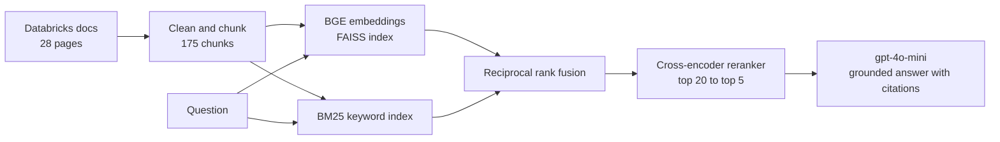

# Databricks Docs Assistant: a measured RAG system

A retrieval-augmented question-answering assistant over public Databricks documentation, built step by step and evaluated at every stage. It answers with citations and says "I don't know" when the documents don't cover a question.

**Headline results** (hand-reviewed test set, 19 answerable questions plus 2 out-of-scope):

- Hybrid search plus a cross-encoder reranker raised **recall@5 from 0.84 to 0.89** and **MRR from 0.68 to 0.76** over dense retrieval.
- The final system answered **18 of 19** in-scope questions correctly, gave **no confidently wrong answers**, and **refused both** out-of-scope questions.
- Error analysis showed that the remaining failures traced back to test labels, not the system (details below).

## How it works

| Stage | Choice | Why |
|---|---|---|
| Corpus | 28 pages, about 40,500 words (Unity Catalog, AI Gateway, Catalog Explorer) | Small enough to evaluate thoroughly |
| Cleaning | Article text only, navigation removed, one paragraph per line | Menu text creates noisy chunks |
| Chunking | Paragraph-aware packing, about 300 words, 50-word overlap (median 283 words) | Keeps sentences whole; every chunk under the 512-token model limit |
| Embeddings | `BAAI/bge-small-en-v1.5`, 384 dimensions, normalized, with the query instruction | Free, runs on CPU |
| Index | FAISS exact inner-product search | 175 vectors need no approximate index |
| Keyword search | BM25 | Exact names and terms |
| Fusion | Reciprocal rank fusion (k = 60) | Combines rankings without comparing incompatible scores |
| Reranker | `cross-encoder/ms-marco-MiniLM-L-6-v2` over 20 candidates | Reads the question and passage together for better ordering |
| Generation | `gpt-4o-mini`, temperature 0, numbered sources in delimiters, cite or say "I don't know" | Grounded, checkable answers |

## Evaluation

### Test set

- An LLM drafted 22 questions from 11 sampled pages, each with an exact supporting quote; code verified 21 of 22 quotes appear on the page.
- I reviewed every draft by hand and kept 13, then added 8 of my own (paraphrase, exact-term and out-of-scope questions).
- Version 1: 21 questions (8 generated, 8 paraphrase, 3 exact term, 2 out of scope). Version 2 repaired one item mislabeled during review.
- Retrieval labels are at page level.

### Retrieval (test set v1, 19 in-scope questions)

| System | recall@1 | recall@3 | recall@5 | recall@10 | MRR@5 | ms/query |
|---|---|---|---|---|---|---|
| Dense (BGE + FAISS) | 0.58 | 0.79 | 0.84 | 0.89 | 0.68 | 67 |
| BM25 | 0.63 | 0.79 | 0.79 | 0.84 | 0.70 | 1 |
| Hybrid (dense + BM25, RRF) | 0.68 | 0.79 | 0.84 | 0.89 | 0.74 | 78 |
| Hybrid + reranker | 0.68 | 0.79 | **0.89** | **0.95** | **0.76** | 8,056 (CPU) |

### Answers (test set v1)

| System | Correct (in scope) | False refusals | Out-of-scope refused |
|---|---|---|---|
| Dense | 16/19 | 3 | 2/2 |
| Hybrid | 16/19 | 3 | 2/2 |
| Hybrid + reranker | 17/19 | 2 | 2/2 |

Correctness was graded by a `gpt-4o-mini` judge with yes/no verdicts; refusals were detected by code. **Judge validation:** on 10 hand-labeled answers, the judge agreed with me 90% of the time on correctness but only 60% on faithfulness, so I report correctness and do not treat faithfulness as reliably measured yet.

### Error analysis and one fix (test set v2)

| Context selection | Correct | Distinct pages in context | Avg input tokens |
|---|---|---|---|
| Top 5 (baseline) | 18/19 | 2.8 | 1,899 |
| Max 2 chunks per page | 18/19 | 3.5 | 1,929 |
| Top 8 | 17/19 | 4.1 | 3,028 |

## Findings

1. **Retrieval was the bottleneck.** Answer correctness matched retrieval recall@5 for every system: when the right page reached the model, it answered correctly.
2. **No confidently wrong answers.** Every failure was a refusal, never a hallucinated answer, and both out-of-scope questions were refused.
3. **Hybrid search improved ranking; the reranker improved coverage.** Hybrid raised first-rank hits from 11 to 13 of 19; the reranker found one more answer in the top 5, at about 100 times the latency on CPU.
4. **Error analysis found label errors, not model errors.** One item had its question saved incorrectly during review (fixed in v2). The last failing question's reference answer names a term that appears nowhere in the crawled pages, so refusing was the correct behavior.
5. **More context is not automatically better.** Sending 8 chunks instead of 5 cost 60% more tokens and produced one more refusal. Capping chunks per page raised the number of distinct pages from 2.8 to 3.5 for 2% more tokens, with no change in accuracy on this test set.
6. **False premises.** Asked "Since Unity Catalog was removed, what replaced it?", the system refused instead of correcting the premise; a prompt rule for this is tested in notebook 07.

## Limitations

- **Small test set:** 19 answerable questions, so one question is about 5 percentage points. Differences are consistent but not statistically established.
- **Page-level labels** can count a retrieval as a hit when the passage holding the answer is missing.
- **Coverage gap:** the crawl collected only one Catalog Explorer page.
- **Single judge model** from the same family as the answer model; faithfulness agreement with human labels was only 60%.
- **Reranker latency** of about 8 seconds per query on Colab's free CPU; a GPU or fewer candidates would be needed in production.

## How to run

Each notebook runs in Google Colab and saves its outputs to Google Drive (`MyDrive/docs-rag`). Add an OpenAI key as a Colab secret named `OPENAI_API_KEY`. Total API cost was under $1.

| Notebook | Step |
|---|---|
| `00_openai_api_basics.ipynb` | Warm-up: structured outputs and embeddings |
| `01_collect_docs.ipynb` | Crawl and clean the docs (respects robots.txt, rate-limited) |
| `02_chunk_embed_index.ipynb` | Chunk, embed and index |
| `03_generate_answers.ipynb` | Grounded answers with citations |
| `04_build_testset.ipynb` | Build and review the test set |
| `05_retrieval_eval.ipynb` | Dense vs BM25 vs hybrid vs reranker |
| `06_answer_eval.ipynb` | Answer grading with a validated LLM judge |
| `07_error_analysis.ipynb` | Error analysis, test set v2, context-selection fix |

The crawled documentation is not stored in this repository; notebook 01 rebuilds it. The test sets and result tables are in `data/` and `results/`.

## Next steps

- Grow the test set with passage-level labels and real user questions.
- Add a claim-level faithfulness judge and re-validate it.
- Move the index to Databricks Vector Search and evaluate with Mosaic AI Agent Evaluation.
- Add a text-to-SQL agent over a sample database.
